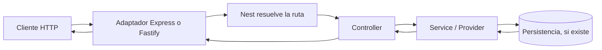

# 01. Fundamentos: de Node.js a una petición NestJS

## El mapa mental

- **JavaScript** es el lenguaje que se ejecuta en el servidor.
- **Node.js** es el runtime que ejecuta JavaScript fuera del navegador y ofrece APIs de sistema y red.
- **TypeScript** añade tipos estáticos al código y se compila a JavaScript.
- **HTTP** es el protocolo con el que un cliente envía una petición y recibe una respuesta.
- **Express** y **Fastify** son frameworks HTTP para Node.js.
- **NestJS** organiza la aplicación en módulos, controladores y providers, y usa un adaptador HTTP (Express por defecto o Fastify si se elige).

NestJS no reemplaza Node.js ni TypeScript. Añade una arquitectura y herramientas sobre un servidor HTTP subyacente.

## ¿Qué problema resuelve NestJS?

En una app pequeña se puede declarar una ruta directamente en Express. Al crecer, aparecen rutas, validación, autenticación, acceso a datos y reglas de negocio. Nest ofrece convenciones para separar esas responsabilidades, conectar clases mediante inyección de dependencias y probarlas por partes.

NestJS es un **framework**. Express/Fastify son frameworks HTTP que Nest integra como plataforma. TypeORM y Prisma son herramientas externas de persistencia; no vienen implícitas en el núcleo.

## Primer endpoint

```ts
import { Controller, Get } from '@nestjs/common';

@Controller('saludo')
export class SaludoController {
  @Get()
  obtenerSaludo(): { mensaje: string } {
    return { mensaje: 'Hola desde NestJS' };
  }
}
```

`@Controller('saludo')` define el prefijo de la ruta. `@Get()` registra una ruta HTTP GET en ese prefijo. Al visitar `GET /saludo`, Nest llama al método y serializa el objeto retornado como JSON.

El controlador necesita registrarse en un módulo para que Nest lo descubra:

```ts
import { Module } from '@nestjs/common';
import { SaludoController } from './saludo.controller';

@Module({ controllers: [SaludoController] })
export class AppModule {}
```

## Piezas y responsabilidades

| Pieza | Responsabilidad | Ejemplo |
|---|---|---|
| Module | Agrupa controllers y providers | `ProductsModule` |
| Controller | Traduce HTTP a llamadas de aplicación | `ProductsController` |
| Provider/service | Ejecuta lógica que se puede inyectar | `ProductsService` |
| DTO | Describe la forma esperada de datos de entrada/salida | `CreateProductDto` |
| Adapter | Conecta Nest con Express o Fastify | `@nestjs/platform-express` |

El ejemplo mínimo del libro mantiene los productos en memoria para enseñar el flujo sin exigir PostgreSQL. Los datos se pierden al reiniciar el proceso; un capítulo posterior sustituirá ese almacenamiento por persistencia real.

## Flujo simplificado



En una aplicación completa pueden ejecutarse middleware, guards, interceptors, pipes y filtros. Cada pieza tiene un propósito y un orden específicos; no son nombres distintos para la misma función. Se desarrollarán en los capítulos de ciclo de petición y componentes.

## NestJS frente a Express/Fastify

Con Express o Fastify se define directamente cómo componer rutas y middleware. Nest puede usar el mismo adaptador, pero añade módulos, DI, decoradores y puntos de extensión comunes. Elegir Nest suele ayudar cuando interesa una estructura consistente o se trabaja en equipo. Una aplicación pequeña puede necesitar menos abstracción.

## Ejercicio

Crea `SaludoController` con `GET /saludo/:nombre` y responde `{ "mensaje": "Hola, Ana" }` para `/saludo/Ana`. Pista: usa `@Param('nombre')`. La solución aparece en el capítulo de controladores.

## Referencias

- [Introducción oficial](https://docs.nestjs.com/)
- [Primeros pasos](https://docs.nestjs.com/first-steps)
- [Controladores](https://docs.nestjs.com/controllers)
- [Express](https://expressjs.com/)
- [Fastify](https://fastify.dev/)
