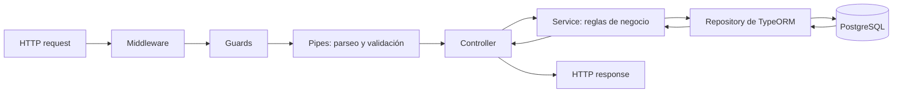

# 09. HTTP, REST y CRUD completo

## Piezas de una petición HTTP

Una petición contiene un método, una ruta, headers y, a veces, un body. Nest selecciona un handler por método y ruta, procesa parámetros y convierte el valor devuelto en una respuesta usando el adaptador HTTP (Express por defecto).

| Operación | Método | Ruta | Entrada principal | Respuesta habitual |
|---|---|---|---|---|
| Listar productos | GET | `/products` | query params opcionales | `200 OK`, lista |
| Obtener uno | GET | `/products/:id` | parámetro de ruta | `200 OK`, recurso o `404` |
| Crear | POST | `/products` | body JSON | `201 Created`, recurso creado |
| Reemplazar | PUT | `/products/:id` | id y body completo | `200 OK`, recurso reemplazado |
| Actualizar parcialmente | PATCH | `/products/:id` | id y campos parciales | `200 OK`, recurso actualizado |
| Eliminar | DELETE | `/products/:id` | parámetro de ruta | `204 No Content` |

`PUT` describe el reemplazo completo de un recurso. `PATCH` cambia algunos campos. En una API real, define y documenta qué semántica ofrece cada endpoint.

## Controller fino y service con operaciones CRUD

El controller conecta HTTP con un service; el service aplica las reglas y usa la persistencia. El ejemplo completo de productos y categorías está en [examples/catalogo-postgres](../examples/catalogo-postgres/README.md). Una ruta de controller se ve así:

```ts
@Controller('products')
export class ProductsController {
  constructor(private readonly products: ProductsService) {}

  @Get()
  findAll() {
    return this.products.findAll();
  }

  @Get(':id')
  findOne(@Param('id', ParseIntPipe) id: number) {
    return this.products.findOne(id);
  }

  @Post()
  create(@Body() dto: CreateProductDto) {
    return this.products.create(dto);
  }

  @Put(':id')
  replace(
    @Param('id', ParseIntPipe) id: number,
    @Body() dto: CreateProductDto,
  ) {
    return this.products.replace(id, dto);
  }

  @Patch(':id')
  update(
    @Param('id', ParseIntPipe) id: number,
    @Body() dto: UpdateProductDto,
  ) {
    return this.products.update(id, dto);
  }

  @Delete(':id')
  @HttpCode(HttpStatus.NO_CONTENT)
  remove(@Param('id', ParseIntPipe) id: number): Promise<void> {
    return this.products.remove(id);
  }
}
```

En un service con persistencia, los métodos de lectura/escritura suelen devolver `Promise`. Nest espera el resultado para responder. Si `findOne` no encuentra el id, lanza `NotFoundException`; Nest lo convierte en HTTP 404.

## Parámetros y códigos HTTP

```ts
@Get()
findAll(@Query('search') search?: string) { /* filtrar */ }

@Post()
create(@Body() dto: CreateProductDto) { /* crear */ }

@Get(':id')
findOne(@Param('id', ParseIntPipe) id: number) { /* buscar */ }
```

`@Body`, `@Param` y `@Query` son decoradores de parámetros de Nest. Un DTO describe el shape esperado; los pipes pueden convertir y validar ese dato antes de llamar al handler.

| Código | Significado habitual | Ejemplo |
|---|---|---|
| 200 | operación correcta con respuesta | GET, PUT, PATCH |
| 201 | recurso creado | POST |
| 204 | operación correcta sin body | DELETE |
| 400 | petición inválida | id que no es entero, DTO inválido |
| 401 | no autenticado | token ausente o inválido |
| 403 | autenticado pero sin permiso | rol insuficiente |
| 404 | recurso inexistente | producto no encontrado |
| 409 | conflicto de estado | nombre de categoría duplicado |
| 500 | fallo inesperado | error no controlado del servidor |

## Respuestas, filtros y paginación

Devuelve recursos o DTOs de respuesta estables; evita retornar secretos internos o entidades con campos privados. Para colecciones grandes usa paginación, límites máximos y ordenamiento allowlisted. Ejemplo de query: `GET /products?page=1&limit=20&sort=name`.

## Flujo del CRUD integrado



Una excepción interrumpe el camino normal y pasa al manejo de excepciones de Nest. Los interceptors envuelven el handler; los veremos en su capítulo.

## Probar con curl

```bash
curl http://localhost:3000/products
curl http://localhost:3000/products/1
curl -X POST http://localhost:3000/products -H "Content-Type: application/json" -d '{"name":"Taza","priceInCents":850,"categoryId":1}'
curl -X PATCH http://localhost:3000/products/1 -H "Content-Type: application/json" -d '{"priceInCents":900}'
curl -X DELETE http://localhost:3000/products/1
```

En PowerShell usa `curl.exe` para invocar el ejecutable curl en vez del alias `Invoke-WebRequest`.

## Errores frecuentes

- Poner la regla de negocio en el controller: muévela al service para que sea reutilizable y testeable.
- Confiar en que `id: number` convierte texto a número: usa `ParseIntPipe`.
- Usar DELETE con respuesta ambigua: documenta si devuelves `204` sin body o `200` con un resultado.
- Retornar errores crudos de PostgreSQL: traduce conflictos esperados a excepciones HTTP como `ConflictException`.

## Referencias

- [NestJS Controllers](https://docs.nestjs.com/controllers)
- [NestJS Request lifecycle](https://docs.nestjs.com/faq/request-lifecycle)
- [HTTP Semantics, RFC 9110](https://www.rfc-editor.org/rfc/rfc9110)
